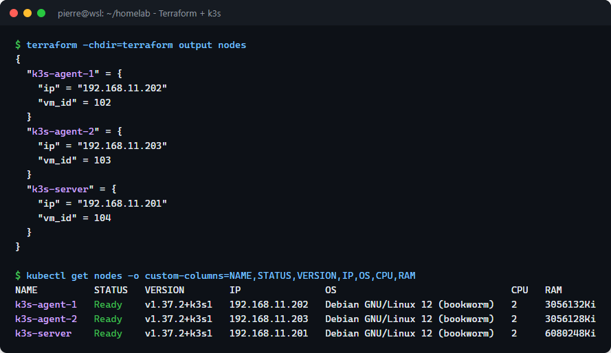
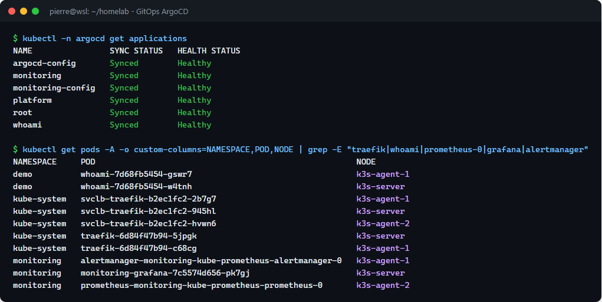
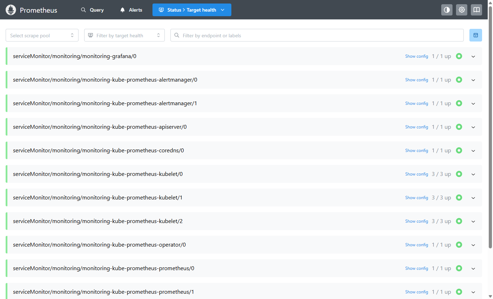
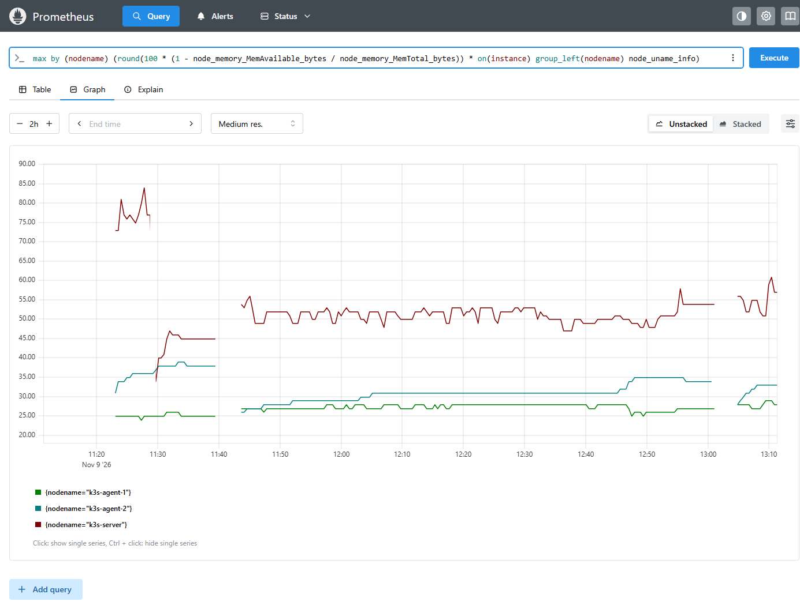
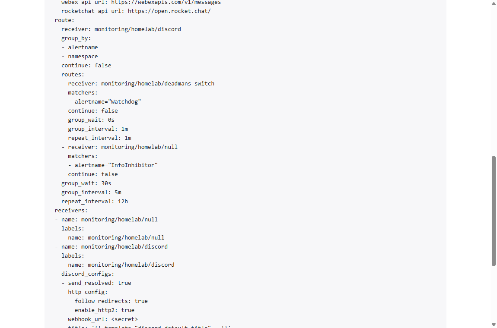
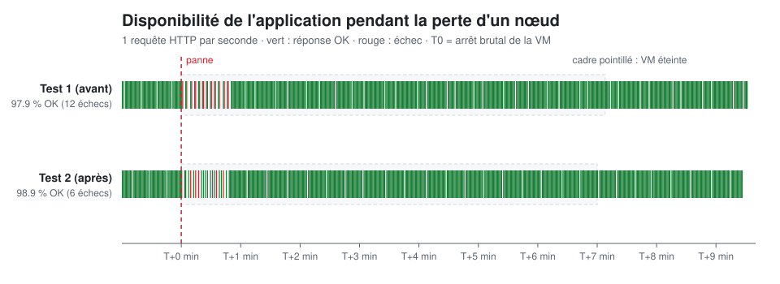

# Homelab : infrastructure d'entreprise as code

Infrastructure complète d'une entreprise fictive, construite sur un serveur **Proxmox VE** et **entièrement décrite en code** : VMs, cluster Kubernetes, déploiements, supervision et alertes se recréent de zéro avec quelques commandes, puis sont **testés en panne réelle**.


| Projet | Contenu | État |
|---|---|---|
| 0. Socle Proxmox | Sauvegardes planifiées, template Debian 12 cloud-init, compte Terraform à privilèges minimaux, bridge VLAN-aware | ✅ |
| **1. Plateforme Kubernetes** | **Terraform → VMs, Ansible → k3s, ArgoCD → GitOps, Prometheus/Grafana/Alertmanager → supervision, tests de panne + post-mortem** | ✅ |
| 2. Réseau automatisé | Fabric spine-leaf BGP/EVPN (containerlab), NetBox, Ansible, tests en CI | ⏳ |
| 3. Sécurité hybride | OPNsense, VLANs, WireGuard, Suricata, Wazuh | ⏳ |

## En bref
- ⚙️ **Infrastructure as code de bout en bout** : `terraform apply` crée les VMs sur Proxmox, `ansible-playbook` installe Kubernetes, puis **tout le reste se déploie par `git push`**.
- 🔐 **Sécurité dès la conception** : compte de service Proxmox aux droits limités au lab, **aucun secret dans Git** (variables d'environnement et Secrets Kubernetes créés hors du dépôt).
- 📊 **Observabilité** : 21 cibles Prometheus, tableaux de bord Grafana, alertes vers Discord et alerte « homme mort » externe.
- 💥 **Résilience prouvée par des mesures** : un nœud coupé brutalement, 2 tests, un [post-mortem](docs/postmortem-2026-11-09-perte-k3s-agent-2.md) et des corrections mesurées (échecs divisés par 2, reprise 4× plus rapide).

---

## Architecture

```
 PC (WSL2)                          Proxmox VE "bekono" - pool homelab
┌──────────────┐  API (token)     ┌────────────────────────────────────────────────┐
│ Terraform    │ ───────────────▶ │ template 9000 (Debian 12 cloud-init)           │
│              │                  │      │ clone                                   │
│ Ansible      │ ── SSH ────────▶ │  k3s-server   .201  control-plane   6 Go       │
│              │                  │  k3s-agent-1  .202  worker          3 Go       │
│ kubectl      │ ── :6443 ──────▶ │  k3s-agent-2  .203  worker          3 Go       │
└──────────────┘                  └────────────────────────────────────────────────┘
        │ git push                                   ▲
        ▼                                            │ synchronise
   GitHub (ce dépôt) ◀──── surveille ──── ArgoCD (dans le cluster)
```



### Choix techniques
- **Compte de service dédié** : Terraform utilise `terraform@pve`, qui n'a de droits d'écriture que sur le pool `homelab`. Une erreur ne peut pas toucher aux autres VMs du serveur.
- **Inventaire Ansible généré par Terraform** : une seule source de vérité pour les IPs.
- **CPU `x86-64-v2-AES`** : le serveur (i7-2600, 2011) ne gère pas AVX2/x86-64-v3.
- **Clé SSH dédiée au lab**, distincte de la clé d'administration.
- **Dimensionnement piloté par la supervision** : `k3s-server` est passé de 4 à 6 Go après une alerte de pression mémoire, en une ligne de Terraform ([6db8e62](https://github.com/bekoco/homelab/commit/6db8e62)).

### Déployer
Depuis WSL :
```bash
source ~/.homelab/proxmox.env                 # voir terraform/proxmox.env.example
cd terraform && terraform init && terraform apply
cd ../ansible && ./run.sh                     # installe k3s
./run.sh bootstrap-secrets.yml                # secrets hors Git (Grafana, alertes)
./run.sh argocd.yml                           # installe ArgoCD, qui déploie tout le reste
export KUBECONFIG=$PWD/../kubeconfig && kubectl get nodes
```

## GitOps avec ArgoCD
ArgoCD surveille ce dépôt : **Git est la seule source de vérité**. Un `git push` suffit pour déployer, et une modification manuelle sur le cluster est automatiquement annulée (*self-heal*).

```
k8s/bootstrap/root-app.yaml   appliqué une fois : « app of apps » qui surveille k8s/apps
k8s/apps/                     une Application ArgoCD par service
k8s/argocd/                   configuration d'ArgoCD (gérée par ArgoCD lui-même)
k8s/platform/                 surcharge des composants k3s (Traefik en haute disponibilité)
k8s/monitoring-config/        routage des alertes
k8s/workloads/whoami/         application de démonstration
```



- Interface ArgoCD : http://argocd.192.168.11.201.nip.io
- Application de démo : http://whoami.192.168.11.201.nip.io

## Supervision et alertes
`kube-prometheus-stack` (Prometheus, Alertmanager, Grafana, node-exporter, kube-state-metrics), déployé par ArgoCD comme n'importe quelle application ([k8s/apps/monitoring.yaml](k8s/apps/monitoring.yaml)).
- Composants que k3s n'expose pas (controller-manager, scheduler, proxy, etcd) désactivés : **aucune cible en erreur, aucune fausse alerte**.
- Données Prometheus persistantes (7 jours, volume `local-path`).
- Identifiants Grafana et URLs d'alerte dans des Secrets créés hors de Git par [`bootstrap-secrets.yml`](ansible/bootstrap-secrets.yml).
- Grafana : http://grafana.192.168.11.201.nip.io



**Utilisation mémoire des nœuds** (heures UTC). On y voit le redimensionnement de `k3s-server` (de ≈ 77 % à ≈ 45 %, à 11:29) et les **deux trous** laissés par les tests de panne (11:40 et 13:01), pendant lesquels Prometheus était sur le nœud coupé :



**Routage des alertes** ([alertmanager-config.yaml](k8s/monitoring-config/alertmanager-config.yaml)) : les alertes partent vers Discord, et l'alerte `Watchdog`, toujours active, est transmise chaque minute à healthchecks.io. Ce service externe prévient quand elle **s'arrête**, c'est-à-dire quand la supervision elle-même est tombée (*dead man's switch*). Les URLs restent masquées (`<secret>`) :



## Résilience : tests de panne
Un nœud du cluster est coupé brutalement via l'API Proxmox pendant 7 minutes, avec une requête HTTP par seconde et un relevé de l'état du cluster toutes les 5 s ([`chaos/node-failure.sh`](chaos/node-failure.sh)). Les hypothèses sont écrites **avant** le test.



| | Test 1 | Test 2, après corrections |
|---|---|---|
| Disponibilité | 97,9 % (12 échecs) | **98,9 % (6 échecs)** |
| Pod recréé ailleurs | T+351 s | **T+81 s** |
| Perte d'un réplica Traefik | 1 seul réplica : point de défaillance unique | **2 réplicas, trafic maintenu** |
| Supervision aveugle | 7 min 36 s, sans alerte | ≈ 7 min 30 s, alerte « homme mort » en place |

👉 **[Post-mortem complet](docs/postmortem-2026-11-09-perte-k3s-agent-2.md)** : chronologie à la seconde, hypothèses et réalité, analyse des causes, corrections mesurées et actions restantes.

### Problèmes réels rencontrés et résolus
| Problème | Détection | Correction |
|---|---|---|
| Agent QEMU impossible à démarrer | Échec du playbook Ansible | Démarrage conditionné à la présence du port virtio |
| `k3s-server` à 76 % de RAM | Alerte `NodeMemoryMajorPagesFaults` | 4 → 6 Go via Terraform, retombé à 35 % |
| Traefik : point de défaillance unique | Cartographie avant le test de panne | 2 réplicas, anti-affinité, PodDisruptionBudget |
| Grafana redémarrant en boucle | Cible Prometheus `DOWN`, OOM kills dans `dmesg` | Limite mémoire 256 → 768 Mo |

## Tout détruire
```bash
cd terraform && terraform destroy
```
