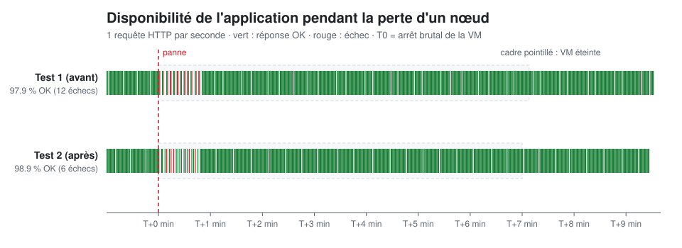

# Post-mortem : perte du nœud k3s-agent-2 (test de panne)

| | |
|---|---|
| **Date** | 2026-11-09, 12:35 → 12:44 |
| **Type** | Test de panne volontaire (*chaos engineering*) |
| **Scénario** | Arrêt brutal de la VM `k3s-agent-2` (équivalent d'une coupure de courant), 7 min d'arrêt, puis redémarrage |
| **Outil** | [`chaos/node-failure.sh`](../chaos/node-failure.sh), journaux bruts dans [`chaos/results/`](../chaos/results/) |
| **Format** | Post-mortem *blameless* : on cherche ce que le système doit améliorer, pas un coupable |

## Résumé
La perte d'un nœud sur trois a été **bien encaissée par l'application** : 97,9 % des requêtes ont abouti sur toute la durée du test, et tout est revenu à la normale sans intervention. Mais le test a révélé deux faiblesses importantes :
1. **La supervision a été aveugle pendant 7 min 36 s et n'a déclenché aucune alerte**, parce que Prometheus tournait justement sur le nœud perdu et que son volume de données l'y attache.
2. **Le point d'entrée web (Traefik) n'a qu'un seul réplica.** Il était sur un autre nœud, par chance : la perte de `k3s-agent-1` aurait coupé **tout** le trafic web.

## Impact
| Mesure | Valeur |
|---|---|
| Requêtes HTTP sur l'application de démo | 569, dont **12 en échec** (timeouts) → **97,9 %** de disponibilité sur le test |
| Pendant les 55 premières secondes | 17 requêtes OK sur 29 (≈ 41 % d'échecs) |
| Ensuite (T+55 s → fin) | **0 échec** : le réplica restant a absorbé tout le trafic |
| Supervision (Prometheus) | **Aucune donnée collectée de T+0 à T+456 s** |
| Alertes déclenchées | **Aucune** (hors `Watchdog`, toujours active par conception) |

## Chronologie
*T0 = arrêt brutal de la VM. Sondes : 1 requête HTTP/s, état Kubernetes toutes les 5 s.*

| Temps | Événement |
|---|---|
| T−61 s | Mesure de référence : 2 réplicas `whoami` (k3s-agent-2 et k3s-server) se partagent le trafic |
| **T+0 s** | **Arrêt brutal de `k3s-agent-2`** via l'API Proxmox |
| T+1 → T+47 s | Une requête sur deux part vers le pod mort et expire (*timeout*) : 12 échecs |
| T+55 s | Kubernetes déclare le nœud `NotReady` et retire ses pods du Service : plus aucun échec |
| T+351 s | Kubernetes expulse les pods du nœud mort (55 s + tolérance par défaut de 300 s) |
| T+351 s | `whoami`, l'opérateur Prometheus et kube-state-metrics sont recréés sur d'autres nœuds |
| T+351 s | **Prometheus reste bloqué en `Terminating`** : son volume `local-path` n'existe que sur `k3s-agent-2` |
| T+428 s | Redémarrage de la VM |
| T+449 s | Nœud de nouveau `Ready` (21 s après le démarrage) |
| T+456 s | Prometheus redémarre sur `k3s-agent-2` : la collecte reprend |
| T+571 s | Fin du test |

## Hypothèses et réalité
| # | Hypothèse | Résultat |
|---|---|---|
| H1 | `whoami` reste disponible, avec au pire quelques erreurs | ⚠️ **Partiellement** : ≈ 41 % d'échecs pendant 55 s avant que Kubernetes ne détecte la panne |
| H2 | Nœud `NotReady` en moins d'une minute | ✅ 55 s |
| H3 | Pods recréés ailleurs après environ 5 min | ✅ T+351 s, soit exactement 55 s de détection + 300 s de tolérance |
| H4 | Prometheus ne peut pas être recréé ailleurs, la supervision est aveugle et rien n'alerte | ✅ **Confirmé** : 7 min 36 s sans données ni alerte |
| H5 | Retour à la normale sans intervention | ✅ Oui, mais sans rééquilibrage (voir plus bas) |

## Analyse
### 1. Les 55 premières secondes d'erreurs
Quand un nœud disparaît brutalement, son kubelet ne peut plus signaler que ses pods sont morts. Kubernetes attend la fin du délai de grâce (`node-monitor-grace-period`) avant de déclarer le nœud `NotReady`, puis retire ses pods du Service. Pendant ce temps, Traefik continue d'envoyer une requête sur deux vers un pod qui ne répond plus, et chaque requête attend son timeout.

### 2. La supervision tombe avec ce qu'elle surveille
Prometheus stocke ses données sur un volume `local-path`, c'est-à-dire un dossier sur le disque de la VM. Ce volume est **lié à un nœud** : Kubernetes ne peut pas recréer Prometheus ailleurs. Résultat :
- aucune métrique pendant la panne (trou visible dans Grafana) ;
- **aucune alerte** : les règles d'alerte sont évaluées par Prometheus, qui était à l'arrêt. Alertmanager tournait sur un nœud sain, mais n'avait plus personne pour lui envoyer d'alertes ;
- c'est **précisément la panne qu'on voudrait voir** qui est devenue invisible.

### 3. Un point de défaillance unique non testé : Traefik
La cartographie faite avant le test montre que Traefik, qui reçoit **tout** le trafic web du cluster, n'a qu'**un seul réplica**, sur `k3s-agent-1`. Ce test ne l'a pas touché, mais une panne de `k3s-agent-1` aurait rendu toutes les applications injoignables pendant au moins 6 minutes.

### 4. Pas de rééquilibrage après le retour du nœud
Après la reprise, les deux réplicas `whoami` sont restés sur `k3s-agent-1` et `k3s-server`. Kubernetes ne redéplace pas les pods qui tournent déjà : le nœud revenu reste presque vide jusqu'au prochain déploiement.

## Ce qui a bien marché
- L'application a continué de répondre grâce à ses 2 réplicas sur 2 nœuds différents.
- Les pods sans état ont été recréés automatiquement, sans intervention.
- Le nœud a rejoint le cluster en 21 s après son redémarrage, et Prometheus est reparti seul.
- ArgoCD n'a rien eu à corriger : l'état réel est revenu conforme à Git.
- Le test lui-même est **automatisé, mesuré et reproductible** : les mêmes commandes donnent les mêmes mesures.

## Actions décidées après le test 1
*Les actions 1 à 6 ont été déployées le jour même, et leur effet est mesuré plus bas.*

| Priorité | Action | Effet attendu |
|---|---|---|
| 🔴 1 | **Alerte « homme mort »** (*dead man's switch*) : envoyer l'alerte `Watchdog` vers un service externe au cluster (par exemple healthchecks.io), qui alerte quand il **cesse** de la recevoir | Être prévenu quand la supervision elle-même tombe |
| 🔴 2 | **Configurer un récepteur Alertmanager** (Discord ou Telegram), avec le secret créé hors de Git | Que les alertes arrivent quelque part |
| 🟠 3 | **Traefik en 2 réplicas** sur 2 nœuds différents (`HelmChartConfig` k3s, géré par ArgoCD) | Supprimer le point de défaillance unique du trafic web |
| 🟠 4 | **Réessai sur un autre réplica** côté Traefik (middleware `retry`) | Masquer les 55 s d'erreurs pour les utilisateurs |
| 🟡 5 | Réduire la tolérance `unreachable` des applications sans état (300 s → 30 s) | Recréer les pods plus vite |
| 🟡 6 | `topologySpreadConstraints` sur les applications | Répartir les réplicas sur des nœuds différents |
| ⚪ 7 | Stockage répliqué (Longhorn) ou 2 réplicas Prometheus | Rendre la supervision elle-même résistante à la perte d'un nœud. Coûteux en RAM pour ce serveur : à évaluer |

## Vérification : deuxième test après les corrections
Le même jour (13:56), même scénario sur le même nœud, après le déploiement des actions 1 à 6. `k3s-agent-2` portait cette fois **un réplica Traefik, un réplica `whoami` et Prometheus**.

| Mesure | Test 1 | Test 2 | |
|---|---|---|---|
| Requêtes en échec | 12 / 569 | **6 / 570** | ✅ divisé par 2 |
| Disponibilité sur le test | 97,9 % | **98,9 %** | ✅ |
| Nœud déclaré `NotReady` | T+55 s | T+49 s | = |
| Pod `whoami` recréé ailleurs | T+351 s | **T+81 s** | ✅ 49 s + tolérance de 30 s (action 5) |
| Trafic web pendant la perte d'un Traefik | non testé | **maintenu** | ✅ le 2e réplica a pris le relais (action 3) |
| Supervision aveugle | 7 min 36 s | ≈ 7 min 30 s | ❌ inchangé : volume lié au nœud (action 7 non faite) |
| Alerte « homme mort » | inexistante | **pings arrêtés de T+264 s à T+538 s** | ⚠️ voir ci-dessous |

### Ce que le deuxième test a appris
**1. Les 6 échecs restants viennent probablement de la couche d'entrée, pas de l'application.** Le réessai Traefik (action 4) protège le chemin Traefik → `whoami`. Mais les requêtes arrivent d'abord sur l'IP de `k3s-server`, où le load balancer intégré de k3s (ServiceLB) les répartit entre **les deux** pods Traefik, y compris celui du nœud mort. Ces requêtes-là expirent avant même d'atteindre Traefik, donc aucun réessai n'est possible. Correction proposée : `externalTrafficPolicy: Local` sur le service Traefik, pour que chaque nœud n'envoie le trafic qu'à son Traefik local.

**2. L'alerte « homme mort » fonctionne, mais avec un délai.** Les journaux d'Alertmanager montrent que les envois vers healthchecks.io ont **continué pendant 4 min 24 s** après la mort de Prometheus. Alertmanager garde une alerte active jusqu'à son expiration, environ 4 cycles d'envoi de Prometheus. Les envois ne se sont arrêtés qu'à T+264 s, et ont repris à T+538 s. Conséquence : avec une période de 5 min et une grâce de 5 min côté healthchecks.io, **cette panne de 7 min serait passée inaperçue**. Avec une période de 1 min et une grâce de 2 min, l'alerte partirait vers T+7 min.

**3. Discord n'a rien reçu, et c'est normal** : sans Prometheus, aucune règle d'alerte n'est évaluée. Seule l'alerte « homme mort », qui est externe, peut signaler ce type de panne.

## Actions restantes
| Priorité | Action | État |
|---|---|---|
| 🔴 | Renseigner les vraies URLs Discord et healthchecks.io (`~/.homelab/*.txt` puis `./run.sh bootstrap-secrets.yml`) | ⏳ à faire par le propriétaire des comptes |
| 🔴 | healthchecks.io : **période 1 min, grâce 2 min** | ⏳ |
| 🟠 | `externalTrafficPolicy: Local` sur le service Traefik, puis rejouer le test | ⏳ |
| 🟠 | IP virtuelle flottante (kube-vip ou MetalLB) : l'adresse d'entrée pointe encore vers `k3s-server` seul | ⏳ |
| ⚪ | Supervision résistante à la perte d'un nœud (stockage répliqué ou 2 Prometheus) | ⏳ à évaluer (RAM) |
